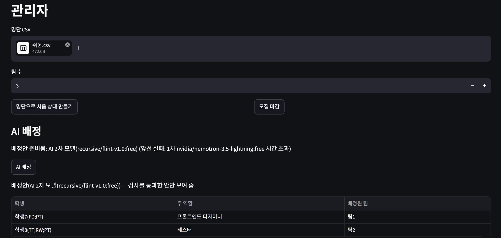
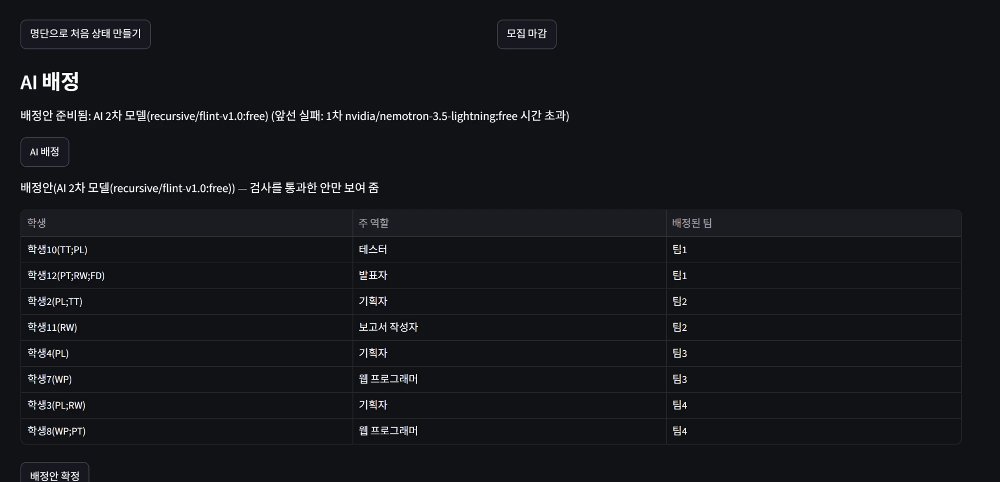
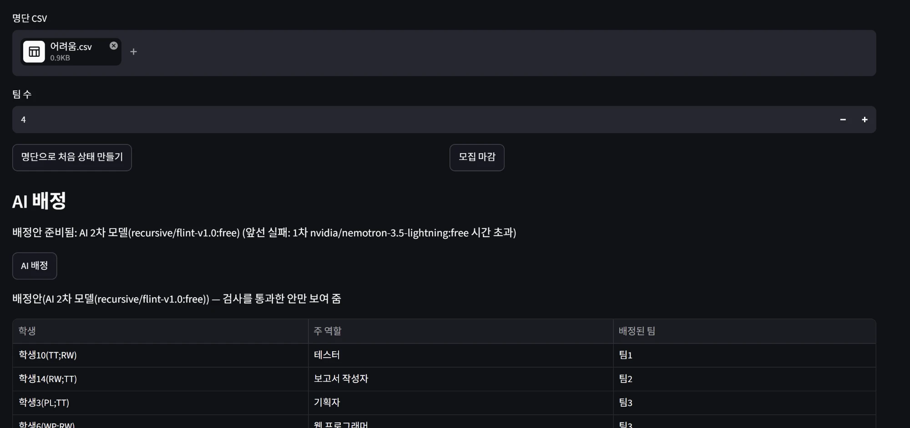
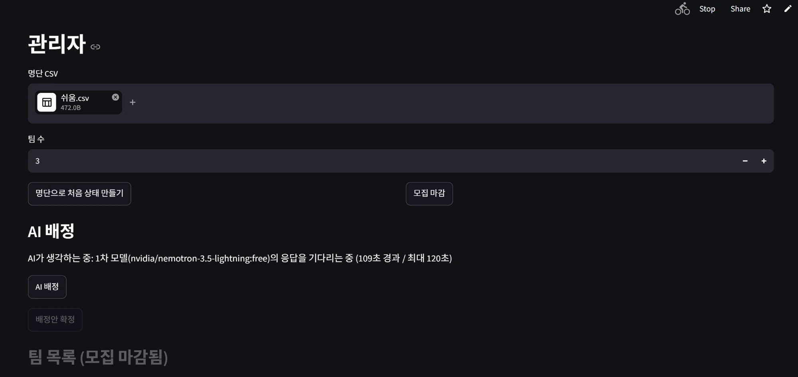
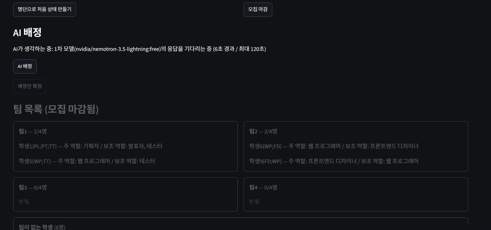

# 팀 편성 웹 앱

작성자: hjw060315-maker

학생이 팀 프로젝트용 팀을 스스로 편성하고, 마감 뒤 남은 학생의 배정은 AI가 돕고 앱이 AI의 답을 규칙으로 검사하는 Streamlit 웹 앱이다. Supabase(Postgres)에 저장하고 OpenRouter 무료 모델을 쓴다.

## 1. 배포 주소
https://study04team-nngmetfdepnmbfzyuggurf.streamlit.app/

## 2. PRD와 구현 계획의 위치
- `docs/PRD.md`
- `docs/구현 계획.md`

## 3. 고른 해결 방법
| 기능 | 고른 해결 |
|---|---|
| 다른 사람의 변경 보기 | 어려운 해결: `st.fragment(run_every=5)`로 5초마다 자동 갱신(`streamlit_app.py`의 `render_board`) |
| 필수 포함 역할을 지킬 수 없는 팀 | 어려운 해결: 지원 단계에서 남는 자리와 채워야 할 필수 역할을 비교해 막음(`src/rules.py`의 `check_join`) |
| 같은 팀에 대기 중인 지원이 여럿 | 어려운 해결: 승인 직전에 규칙을 다시 검사하고, 처리 순서는 투표가 끝난 순서임(`src/service.py`의 `_settle`) |
| 마지막 자리에 두 명이 동시에 들어감 | 어려운 해결: `tf_members`의 `(team_id, slot_no)` 기본키와 `student_id` 유일 제약이 먼저 도착한 학생만 기록함(`schema.sql`) |
| AI 응답이 늦을 때 | 어려운 해결: 모델마다 120초 전체 대기 시간을 직접 재서 끊고 다음 모델로 넘어감(`src/assign.py`의 `call_with_deadline`) |
| 3차 모델까지 실패 | 어려운 해결: 앱이 모든 경우를 따져 5가지 검사를 통과하는 배정을 찾음(`src/assign.py`의 `solve`) |
| AI 대기 중 화면 | 어려운 해결: 몇 차 모델의 응답을 몇 초째 기다리는지 `assign_status`에 보여 줌 |
| DB 일시정지 막기 | 어려운 해결: GitHub Actions(`.github/workflows/keepalive.yml`)가 매일 DB에 질의를 보냄. 저장소 Actions 시크릿에 `DATABASE_URL`을 등록해 두었고, 수동 실행으로 성공(초록 체크)을 확인함 |
| 앱 잠들지 않게 하기 | GitHub Actions(`.github/workflows/keep-app-awake.yml`)가 4시간마다 실제 브라우저로 배포 앱을 열어 12시간 무접속 잠들기를 막음(잠들어 있으면 깨움) |

## 4. 쓴 모델 3개
1차 `nvidia/nemotron-3.5-lightning:free`, 2차 `recursive/flint-v1.0:free`, 3차 `xingchen-agi/xing4.0-29b-a4b:free`

모두 무료 모델이다. `openrouter/free` 라우터는 쓰지 않았다. 앞서 노트의 모델 `minimax/minimax-m3:free`(HTTP 404)와 `nvidia/nemotron-3-super-120b-a12b:free`(제공사가 "Not found"를 돌려줌)는 호출이 되지 않아 바꿨다(`docs/evidence/ai-failures.md`).

## 5. 오픈라우터 AI 모델 호출 실패 사례
- **1차 모델이 120초 안에 응답하지 않아 2차 모델로 넘어감.** 앱이 120초에 끊고 2차 `recursive/flint-v1.0:free`로 넘어가 31.6초 만에 성공했다. 배정 한 번에 약 152초가 걸렸다. 앱의 호출 기록 `tf_ai_logs`의 4·5번 행이 근거이다(`docs/evidence/ai-call-log.md`).
  - 쉬움 시나리오(2026-10-23): 배정안 화면에 "배정안 준비됨: AI 2차 모델(recursive/flint-v1.0:free) (앞선 실패: 1차 nvidia/nemotron-3.5-lightning:free 시간 초과)"가 나온다.
    
  - 중간 시나리오(같은 날): 같은 안내와 검사를 통과한 배정안 표.
    
  - 어려움 시나리오(같은 날): 같은 모양으로 2차 모델이 성공.
    
- **세 모델이 모두 빈 응답이거나 JSON이 없어 앱이 직접 배정함.** 1차와 2차는 "빈 응답", 3차는 "JSON을 찾을 수 없음"이었다(같은 기록의 1~3번 행). 이 경우 앱이 5가지 검사를 통과하는 배정을 직접 찾아 관리자에게 보여 줬다.
- **모델 호출 자체가 실패한 사례.** 노트의 모델 두 개가 HTTP 404였다(`docs/evidence/ai-failures.md`).

## 6. 클로드가 잘못된 추론이나 답변을 한 사례
- **사례:** 클로드가 AI 호출의 응답 길이 한도(`max_tokens`)를 4000으로 충분하다고 보고 코드를 만들었다. 그런데 배정에 쓴 무료 모델들은 답하기 전에 오래 "생각"해서, 학생이 6명쯤 되는 배정에서 생각이 한도를 다 써 버리고 답이 비었다.
- **알아챈 방법:** 관리자 화면에서 AI 배정을 돌렸더니 세 모델이 모두 실패하고 앱이 직접 배정했다. `tf_ai_logs`를 보니 1·2차가 "빈 응답"이었고(`docs/evidence/ai-call-log.md`의 1~3번 행), 그래서 같은 모델 중 하나를 따로 불러 응답 구조를 살펴보니, 생각(reasoning)에만 8,000자 넘게 쓰고 있었다.
- **고침:** 한도를 12000으로 늘리고, 한도 때문에 답이 비면 그 이유를 기록하게 했다(`src/assign.py`, 커밋 38c9691).
- **같은 종류의 또 다른 사례:** 클로드가 만든 UI 시험이 "AI 배정" 단추를 눌러, 키가 생긴 뒤부터 가짜가 아닌 실제 OpenRouter 무료 모델을 호출하고 있었다. 시험 하나가 실패해서 알아챘고, 시험 안에서는 네트워크 호출을 막도록 고쳤다(`tests/test_ui.py`의 `no_network`, 커밋 38c9691).

## 7. 본인이 제출한 앱에서 발견한 문제점
- **문제:** 마감 뒤 "AI 배정"이 느리다. 1차 모델이 자주 120초를 다 쓰고 끊긴 뒤에야 2차가 성공해서, 배정 한 번에 2분 반 넘게 걸린다. 무료 모델이 느리거나 응답하지 않는 일을 앱이 막을 수는 없고, 앞 모델이 실패해야만 다음 모델을 부른다.
- **발견한 곳:** 부록 쉬움 6단계(관리자가 마감하고 배정, 확정), 중간 11단계, 어려움 15단계. 세 시나리오 모두 배정 단계에서 1차 모델이 시간 초과이거나 호출 오류로 실패한 뒤 2차가 성공했다. 근거: `docs/evidence/scenario-real-run.txt`(세 시나리오의 실제 실행 결과)와 `tf_ai_logs` 4·5번 행(1차 시간 초과 120.0초 → 2차 성공 31.6초). 대기 중에는 `assign_status`가 "AI가 생각하는 중: 1차 모델(...)의 응답을 기다리는 중 (N초 경과)"를 보여 주어 멈춘 것처럼 보이지는 않는다.
  - 쉬움 시나리오에서 1차 모델을 109초째 기다리는 화면("109초 경과 / 최대 120초"): 
  - 중간 시나리오에서 마감 뒤 팀이 없는 학생 8명을 두고 1차 모델을 기다리는 화면(6초 경과): 
- **개선 방향:** 모델을 동시에 불러 먼저 검사를 통과한 답을 쓰거나, 1차 모델을 더 빠른 모델로 바꾼다. 다만 동시 호출은 무료 하루 한도(50회)를 더 빨리 쓰므로 채택하지 않았다.

## 실행 방법
```
pip install -r requirements.txt
cp .env.example .env   # 값을 채운다
streamlit run streamlit_app.py
python -m pytest tests
```
